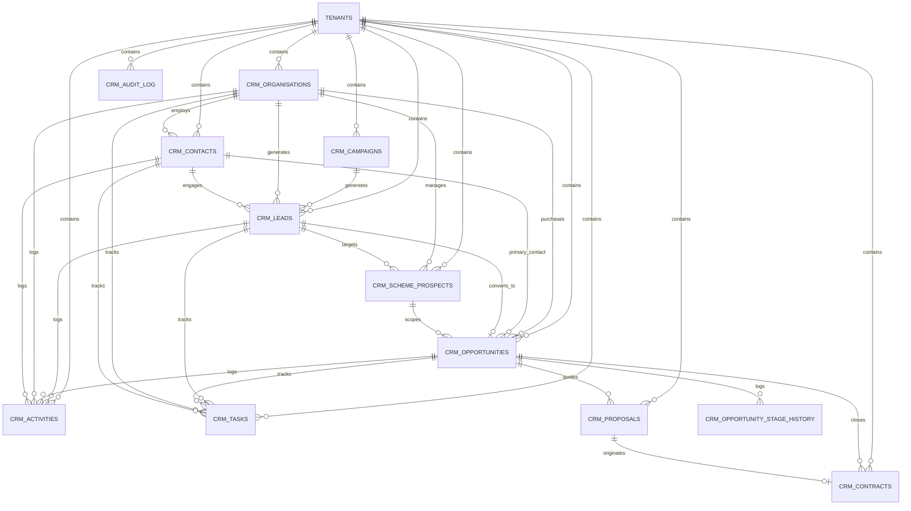

# BCIP CRM Entity Relationship Diagram (ERD)

## 1. Mermaid Entity-Relationship Diagram



---

## 2. ASCII Conceptual Entity Model

```
+--------------------------------------------------------------------------+
|                                TENANT                                    |
+--------------------------------------------------------------------------+
      |
      +----------> [ CAMPAIGN ]
      |                 |
      |                 v
      +----------> [ LEAD ] ---------------------+
      |                 | (Converts To)          |
      |                 v                        v
      +----------> [ ORGANISATION ] ----> [ CONTACT ]
      |                 |                        |
      |                 v                        |
      +----------> [ SCHEME PROSPECT ]           |
      |                 |                        |
      |                 v                        v
      +----------> [ OPPORTUNITY ] <-------------+
      |                 |
      |                 +---> [ OPPORTUNITY STAGE HISTORY ]
      |                 |
      |                 +---> [ ACTIVITIES ] & [ TASKS ]
      |                 |
      |                 +---> [ PROPOSAL ]
      |                             |
      |                             v
      +-------------------------> [ CONTRACT ]
```

---

## 3. Cardinality Rules

1. **Tenant to All Entities:** `1 : N` (Every entity strictly references one tenant; records are never shared across tenants).
2. **Organisation to Contacts:** `1 : N` (An organisation has zero or more contacts).
3. **Organisation to Scheme Prospects:** `1 : N` (A managing agent or body corporate manages zero or more scheme prospects).
4. **Lead to Opportunity:** `1 : 1` (A converted lead maps to exactly one primary opportunity).
5. **Opportunity to Stage History:** `1 : N` (Append-only audit trail recording every stage change).
6. **Opportunity to Proposals:** `1 : N` (An opportunity can have multiple proposal revisions, but at most one accepted).
7. **Proposal to Contract:** `1 : 1` (An accepted proposal can originate a legal contract).
8. **Activities/Tasks to Entities:** Polymorphic `N : 1` (An activity or task can be linked to a lead, contact, organisation, or opportunity).
